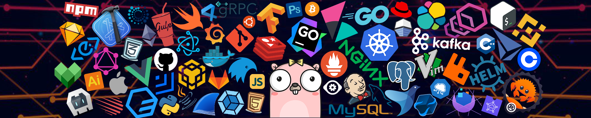

# ✨ Hey, I'm **Phoenix Ye**

🛠 **Backend Engineering** · 📊 **Data Visualization** · 🧠 **LLM Applications & RAG**

Building practical LLM applications for knowledge retrieval, analytics, and business workflows.

---

## 🚀 About Me

- 🛠 Building **Java / Spring Boot backend services** with REST APIs, data validation, and external system integrations.
- 📊 Creating **Vue 3 / ECharts dashboards** with interactive maps, chart drill-downs, and consistent reporting data.
- 🧠 Developing **LLM assistants, RAG systems, and agent workflows** for knowledge retrieval and natural-language analytics (NL → SQL).
- 🎮 Creator with **115K+ followers on Bilibili**, experienced in real-time interaction and user behavior  

---

## 🧰 Tech Stack

I work across Java backend services, interactive Vue dashboards, and LLM applications for retrieval and analytics.

| Area | Technologies |
| --- | --- |
| 🏗️ Backend | **Java · Spring Boot · MyBatis / MyBatis-Plus** · Python · FastAPI |
| 🖥️ Frontend & Visualization | **Vue 3 · TypeScript · ECharts** · Vite · Element Plus |
| 🗄️ Data & Integration | MySQL · PostgreSQL · Redis · Kafka · Apache POI · REST APIs · OAuth 2.0 |
| 🧠 LLMs & Data | LLMs · RAG · Agent Systems · NL → SQL · Data Pipelines |
| 🔧 Build & Delivery | Git · Maven · Jenkins · Docker · AWS |
| 💻 Languages | Java · Python · JavaScript · TypeScript · SQL · Go · C++ |
| ⚙️ Systems Concepts | Event Streaming · Distributed Systems · Low-Latency Design · Observability |

### Applied in Practice

- **Backend & integration:** REST API design, OAuth 2.0 client integration, scheduled synchronization, and transactional persistence.
- **Dashboards:** interactive charts, geographic visualization, and filtered drill-down views with Vue 3 and ECharts.
- **Data correctness:** validated Excel imports, consistent aggregation and pagination, and explicit handling of zero, missing values, and saved vs. live data.

---

## 🚀 Featured Project — Banking Knowledge & Data Copilot

A copilot built with **LLMs, RAG, SQL analytics, and agent routing** for business workflows.

### ✨ What makes it interesting

- 🤖 RAG-based policy & SOP question answering  
- 📊 SQL-powered analytics queries (NL → SQL)  
- 🔀 Explicit agent routing (RAG / SQL / clarification)  
- 🛡 Readonly safety controls for risk-sensitive scenarios  
- 🇨🇳 Supports Chinese banking workflows (KYC · support · KPI analytics)

---

## 🧪 Current Focus

- 🤖 Building **LLM assistants and agent workflows**
- 🧠 Designing **RAG-based knowledge systems**  
- 📊 Developing **natural-language analytics interfaces**  
- 🏗️ Backend infrastructure for **LLM applications**

---

## 🎮 Creator Background — Bilibili

- 📡 Livestream gameplay & technical analysis  
- 💬 Experienced with large-scale chat systems & audience interaction  
- 🧪 Deep understanding of latency, engagement loops, and user behavior  

⭐ 115K+ followers  
🔗 https://space.bilibili.com/255152

---

## 🌐 Studio

🧪 **CinderTide Studio**  
Building LLM applications for business workflows and knowledge retrieval.

🔗 https://phoenix5980.github.io/cindertide-studio-site/
